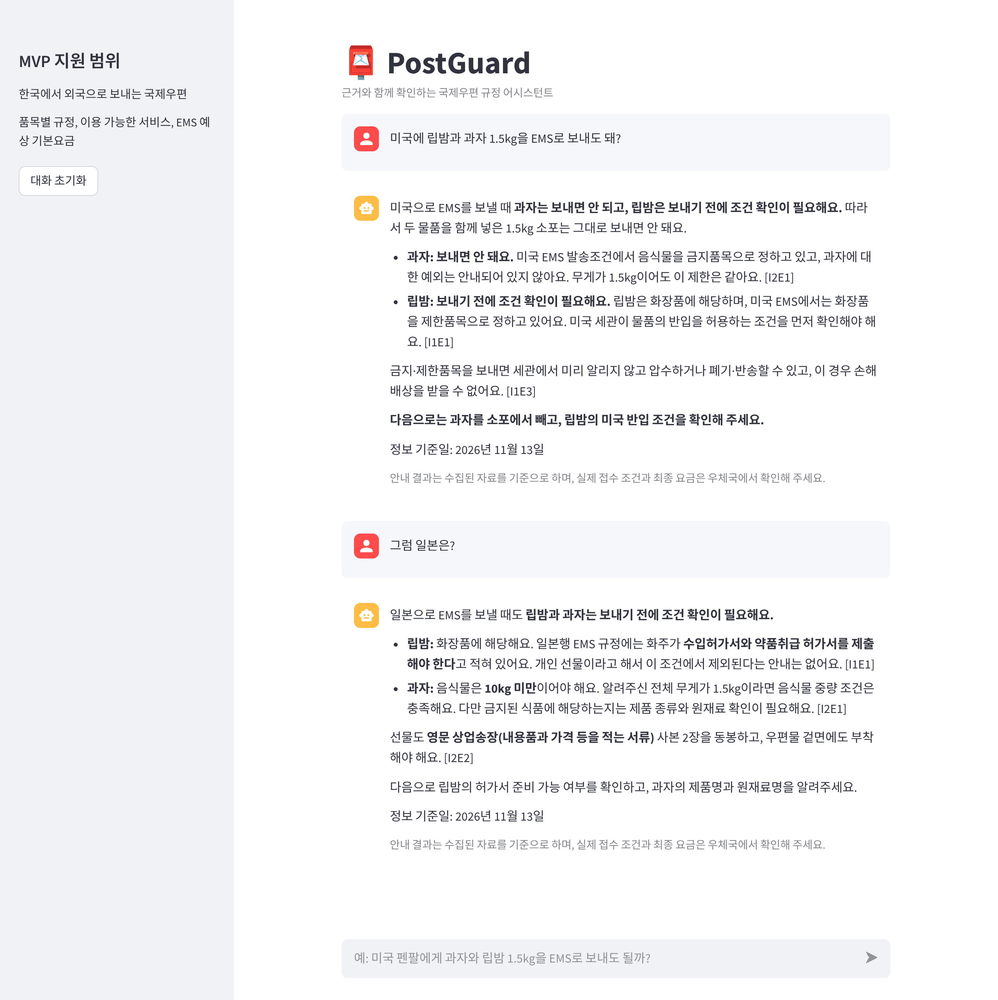
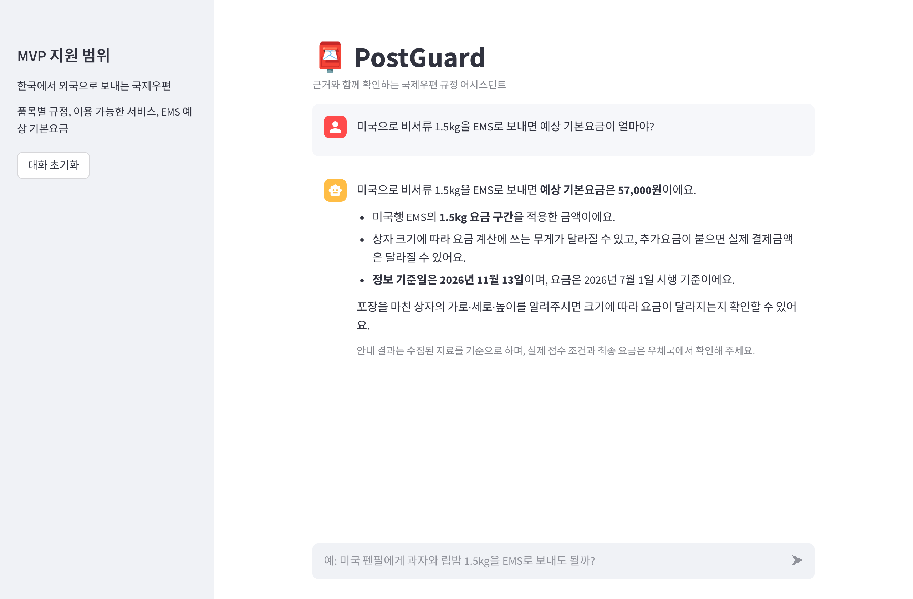
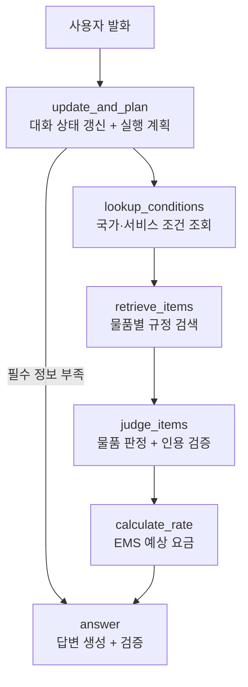

# 📮 PostGuard

**국가별 국제우편 규정을 근거와 함께 알려주는 멀티턴 RAG 어시스턴트**

보낼 나라와 물건을 말하면, 그 물건을 보낼 수 있는지 우체국 발송조건 원문을 인용해 알려줍니다.
"그럼 일본은?"처럼 이어서 물어도 앞에서 말한 물건과 무게를 기억합니다.



<sub>화면 예시. 대화 평가에서 실제로 생성된 답변을 앱 화면 형식으로 재구성했습니다.</sub>

## 한눈에 보기

- **231개국** 우체국 발송조건, 우체국 공통 안내 14건, 국제우편 법령·고시 14건을 직접 수집해 근거로 사용
- 물품마다 **금지 / 조건부 / 제한 없음**을 판정하고, 판정 근거가 된 원문 구절을 인용
- 인용문이 실제 원문에 있는지 **코드로 검증**해, 근거 없는 판정은 걸러냄
- 국가·물품·무게를 기억하는 **멀티턴 대화**와 EMS 예상 요금 안내

## 왜 만들었나

해외 펜팔에게 편지와 선물을 보낼 때마다, 이 나라에 과자를 보내도 되는지, 립밤은 괜찮은지,
어떤 우편 서비스를 써야 하는지를 여러 우편규정 페이지에서 직접 찾아야 했습니다. 국가마다
금지품목이 다르고, 잘못 보내면 상대국 세관에서 반송되거나 폐기됩니다.

이 문제에서는 그럴듯한 답보다 **어느 규정에 따른 답인지**가 중요하다고 봤습니다. 그래서
LLM이 아는 내용으로 답하지 않고, 수집한 규정 원문을 찾아 그 범위 안에서만 판정하고 근거를
함께 보여주는 어시스턴트를 만들었습니다.

## 주요 기능

### 물품별 발송 가능 여부

물품마다 따로 판정하고, 각 판정에 근거 번호(`[I1E1]` 등)를 붙입니다.

| 판정 | 화면 표시 |
|---|---|
| 금지 | 보내면 안 돼요 |
| 조건부 | 보내기 전에 조건 확인이 필요해요 |
| 제한 없음 | 현재 확인한 규정에서는 제한이 없어 보낼 수 있어요 |
| 충돌 | 출처별 규정이 달라요 |
| 근거 부족 | 판단할 근거가 부족해요 |

"제한 없음"은 허용을 보장한다는 뜻이 아니라, 확인한 규정에서 제한을 찾지 못했다는 뜻으로
구분해 안내합니다.

### 이어지는 대화

| 이어서 하는 말 | 처리 |
|---|---|
| 그럼 일본은? | 목적지만 일본으로 바꾸고 물건·무게는 유지 |
| 립밤은 빼고 앞치마를 추가해줘 | 립밤 제거, 앞치마 추가 |
| EMS 예상 기본요금도 알려줘 | 저장된 국가와 무게로 요금 계산 |

### 이용 가능한 서비스와 EMS 예상 요금

국가별 이용 가능 서비스(EMS, EMS프리미엄, 국제소포, 국제통상, K-Packet)를 안내하고, 요청하면
EMS 비서류 예상 기본요금을 계산합니다(2026년 7월 1일 시행 요금 고시 기준).



<sub>화면 예시. 대화 평가에서 실제로 생성된 답변을 앱 화면 형식으로 재구성했습니다.</sub>

## 아키텍처



각 단계는 실행 계획에 자기 작업이 있을 때만 동작합니다. 예를 들어 "미국에 립밤 보내도 돼?"는
검색과 판정만, "미국으로 1.5kg EMS 요금은?"은 조건 조회와 요금 계산만 실행합니다.

| 역할 | 담당 |
|---|---|
| 대화에서 국가·물품·무게·서비스 추출 | LLM |
| 실행할 작업 결정 | 코드 |
| 국가별 서비스 조건 조회, EMS 요금 계산 | 코드 (구조화 데이터) |
| 규정 근거 검색 | ChromaDB |
| 자연어 규정으로 물품 판정 | LLM (검색된 근거 안에서만) |
| 인용문·답변 속 숫자의 출처 검증 | 코드 |

자세한 구조는 [docs/ARCHITECTURE.md](docs/ARCHITECTURE.md)에 있습니다.

## 기술적 의사결정

### 자유형 에이전트 대신 정해진 경로의 워크플로

LLM이 도구를 골라 반복 호출하는 ReAct 에이전트 대신, 질문을 분석해 필요한 단계만 실행하는
LangGraph 워크플로를 택했습니다. 국제우편 질문은 처리 경로가 명확하고, 서비스 조건과 요금은
매번 같은 답이 나와야 합니다. 경로가 고정되어 있어 단계별로 테스트하기도 쉽습니다.

### 숫자와 조건은 LLM이 아닌 코드로

최대 중량, 이용 가능 서비스, 요금처럼 틀리면 안 되는 값은 구조화 데이터(`countries.json`,
요금 고시)에서 코드로 계산합니다. LLM은 자연어로 쓰인 금지·제한 규정을 해석하는 데만 쓰고,
최종 답변에 근거·입력·계산 결과에 없는 무게·길이·금액이 나오면 다시 생성하게 합니다.

### 물품마다 따로 검색하고 판정

"과자와 립밤"을 한 번에 검색하면 과자의 근거가 립밤 판정에 섞입니다. 물품마다 따로 검색하고,
목적지 국가 규정과 모든 국가에 적용되는 공통 금지물품(리튬 배터리, 향수 등)을 함께 찾습니다.
판정은 그 물품의 근거만 보고 내리며, 인용한 구절이 원문에 그대로 있는지 코드로 확인합니다.

### 대화 안에서 판정 재사용

물품 판정 결과를 `(국가, 서비스, 물품)` 키로 대화 안에 저장해 둡니다.

- 같은 조건의 판정이 턴마다 바뀌지 않습니다. LLM 판정은 실행할 때마다 조금씩 달라질 수 있습니다.
- 물품을 하나 추가하면 그 물품만 새로 검색·판정합니다. 판정은 물품당 몇 초가 걸리는 작업입니다.
- 목적지나 서비스가 바뀌면 키가 달라져 자동으로 다시 판정하므로, 변경 사항별 무효화 규칙을
  따로 관리하지 않습니다.

## 데이터

| 구분 | 규모 | 출처 |
|---|---|---|
| 국가별 발송조건 | 231개국 (국제통상 223, EMS프리미엄 206, 국제소포 199, EMS 103, K-Packet 51) | 인터넷우체국 |
| 우체국 공통 안내 | 14건 (보낼 수 있는/없는 물품, 서비스 안내, 손해배상, 검역 등) | 인터넷우체국 |
| 법령·고시 | 14건 (우편법, 국제우편규정, 국제우편 관련 고시 10건) | 국가법령정보센터 |

- 국가별 조건은 서비스마다 제한중량·규격·금지품목·통관 사항을 담은 구조화 데이터와 문서로
  함께 정리했습니다.
- 고시에 첨부된 별표(HWP, HWPX, PDF)에서 우편물 종류별 규격·요금표를 추출했습니다.
- 기준일은 2026년 11월 13일입니다. 출처와 이용 조건은 [data/SOURCES.md](data/SOURCES.md)에 있습니다.

## 기술 스택

Python 3.12 · LangGraph · LangChain · ChromaDB · Streamlit · OpenAI 호환 LLM API · pytest · uv

## 실행 방법

### 설치

```bash
uv sync --group dev
```

`.env.example`을 참고해 프로젝트 루트에 `.env`를 만듭니다. OpenAI 호환 API라면 업체에 관계없이
쓸 수 있습니다.

```bash
LLM_KEY=...
LLM_BASE_URL=https://gms.ssafy.io/gmsapi/api.openai.com/v1
LLM_CHAT_MODEL=gpt-4o
LLM_EMBEDDING_MODEL=text-embedding-3-small
LLM_USE_RESPONSES_API=true
```

### 문서 색인과 실행

```bash
uv run python scripts/index_documents.py
```

```bash
uv run streamlit run app.py
```

색인은 임베딩 모델별로 `chroma_db/<임베딩 모델>/`에 저장됩니다. 임베딩 모델을 바꾸면 다시
색인해야 합니다.

### 테스트

```bash
uv run pytest -q
```

LLM을 호출하지 않고 실행됩니다. 국가 조건 조회, 실행 계획, 멀티턴 상태 변경, 청킹, 검색 필터,
인용 검증, 요금 계산, 멀티턴 판정 재사용(그래프 통합 테스트)을 다룹니다.

---

안내 결과는 수집된 자료를 기준으로 하며, 실제 접수 조건과 최종 요금은 우체국에서 확인해야 합니다.
