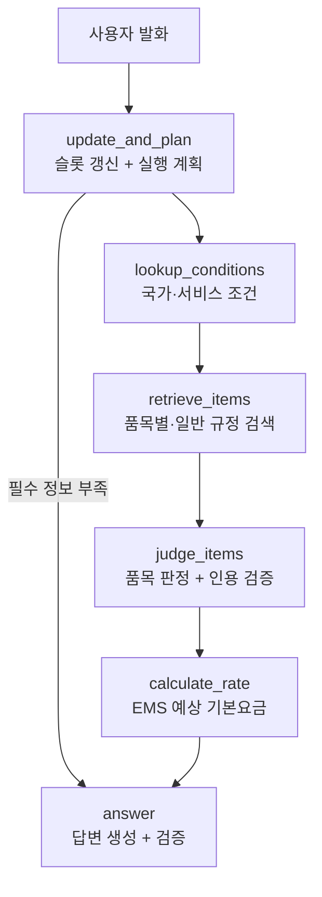

# PostGuard 아키텍처

국제우편 규정 RAG 어시스턴트의 처리 구조와 설계 이유를 정리한다. 코드와 다른 내용이
생기면 이 문서를 코드에 맞춰 고친다.

## 1. 역할 분리

| 역할 | 담당 | 위치 |
|---|---|---|
| 국가·품목·중량·서비스 추출, 슬롯 변경 연산 추출 | LLM | `analysis.py` |
| 실행할 작업 결정 | 코드 | `planner.py` |
| 국가별 서비스 조건 조회 | 코드 (`countries.json`) | `countries.py` |
| 규정 근거 검색 | ChromaDB | `vector_store.py` |
| 자연어 규정의 품목 판정 | LLM (검색 근거 안에서만) | `judgment.py` |
| 판정 인용문이 원문에 있는지 검증 | 코드 | `judgment.validate_decision` |
| EMS 예상 기본요금 | 코드 (요금 고시 파싱) | `rates.py` |
| 답변 작성 | LLM | `answering.py` |
| 답변의 인용 ID·수치 출처 검증 | 코드 | `validation.py` |

LLM은 대화를 이해하고 자연어 규정을 근거 안에서 판정한다. 재현성이 필요한 서비스 조건,
요금, 인용과 숫자 검증은 코드가 맡는다.

## 2. 파이프라인

자유롭게 도구를 반복 호출하는 ReAct 에이전트 대신, 요청을 분석해 정해진 경로만 실행하는
LangGraph 워크플로를 쓴다. 국제우편 질의는 처리 경로가 명확하고, 수치와 서비스 조건은
재현성이 중요하며, 노드별 테스트가 쉽기 때문이다.

- 그래프에는 노드 6개가 있다. 각 노드는 실행 계획(`plan.operations`)에 자기 작업이 없으면
  아무것도 하지 않고 넘어간다. 그래서 질문마다 필요한 작업만 실행된다.
- `update_and_plan`은 슬롯 갱신과 계획 수립을 한 노드에서 한다. 둘 사이에 분기가 없어
  나눌 이유가 없다.
- 인용 검증은 품목마다 판정 직후 해야 하므로 별도 노드가 아니라 `judge_items` 안에서
  실행한다. 답변 검증도 `answer` 안에서 실행한다(5장).

| 질문 예 | 실행되는 작업 |
|---|---|
| 미국에 립밤을 보내도 돼? | 품목 검색, 품목 판정 |
| 일본으로 이용할 수 있는 서비스가 뭐야? | 국가 조건 조회 |
| 미국으로 1.5kg EMS 요금은? | 국가 조건 조회, 요금 계산 |
| 부피중량이 뭐야? | 일반 규정 검색 |

## 3. 멀티턴 상태

LangGraph `MemorySaver`에 Streamlit 세션별 `thread_id`로 대화 상태를 저장한다.

- **슬롯**: 목적지, 품목 목록, 실제 중량, 규격, 희망 서비스
- **슬롯 변경 연산**: `keep / replace / add / remove / clear`. "그럼 일본은?"은 목적지만
  `replace`하고 품목·중량·서비스는 유지한다.

### 품목 판정 캐시

매 턴 결과(국가 조건, 근거, 판정, 요금)를 비우고 그 턴에 요청된 작업을 다시 실행한다.
단, **LLM 품목 판정만은 대화 안에서 재사용한다.**

- **키**: `국가|서비스|품목`. 국가나 서비스가 바뀌면 키가 달라져 자동으로 다시 판정한다.
  변경된 필드마다 무엇을 무효화할지 규칙을 따로 두지 않으므로, 규칙 누락으로 오래된
  판정이 남는 일이 없다.
- **이유**
  - 일관성: 같은 조건에서 립밤 판정이 턴마다 "제한"과 "근거 부족"을 오가지 않는다.
  - 비용: "앞치마도 추가해줘"에서는 앞치마만 검색·판정한다.
- **근거 ID 재매김**: 근거 ID는 품목 순서(`I{품목}E{근거}`)를 따른다. 품목을 빼면 순서가
  바뀌므로, 캐시된 판정을 쓸 때 근거와 인용의 ID를 현재 순서로 다시 매긴다.
- **캐시하지 않는 것**: "근거 부족" 판정은 일시적 검색 실패일 수 있어 저장하지 않는다.
- 국가 조건 조회와 요금 계산은 결정적인 코드라 재사용하지 않는다.

## 4. 검색

### 데이터 분리

- **구조화 데이터** `data/countries.json`: 국가별 서비스, 최대 중량·규격, 요금 지역.
  벡터 검색이 아니라 코드로 직접 조회한다.
- **비정형 문서** (국가별 발송조건, 우체국 공통 안내, 법령·고시): ChromaDB
  `postal-regulations` 컬렉션에 색인한다.

### 청킹

Markdown 제목 단위로 섹션을 나누고, 1,200자를 넘는 섹션만 120자 겹침으로 다시 나눈다.
청크 앞에 문서명과 섹션 경로(예: `미국 > 국제특급(EMS) > 금지·제한품목`)를 붙여, 짧은
청크도 어느 국가·서비스의 규정인지 알 수 있게 한다. 메타데이터는 Chroma 필터를 위해
리스트가 아닌 단일 문자열(`country_code`, `service_type` 등)로 저장한다.

### 품목별 검색과 필터

- 여러 품목을 한 번에 검색하지 않고 품목마다 따로 검색한다. 과자의 근거가 립밤 판정에
  섞이지 않게 하기 위해서다.
- 국가 문서(`country_code = 국가`)와 공통 문서(`country_code = ALL`)를 각각 검색해 합친다.
- 서비스를 지정한 경우 **검색 단계에서** `service_type ∈ {서비스, ALL}` 조건을 함께 건다.

> **수정 이력**: 처음에는 국가 필터로 상위 k개를 가져온 뒤 파이썬에서 서비스를 걸렀다.
> 국가 문서에는 서비스 5개의 섹션이 섞여 있어, 상위 k개가 다른 서비스 청크로 채워지면
> 요청한 서비스의 근거가 0개가 될 수 있었다. 필터를 검색 조건으로 옮기고 회귀 테스트
> (`test_service_filter_is_applied_before_top_k`)를 추가했다. 이 테스트는 수정 전 코드에서
> 실패한다.

## 5. 판정과 답변 검증

### 품목 판정

LLM에는 품목 하나와 그 품목의 검색 근거만 주고, 구조화 출력으로 상태·이유·인용을 받는다.

| 상태 | 사용자 표시 |
|---|---|
| `prohibited` | 보내면 안 돼요 |
| `restricted` | 보내기 전에 조건 확인이 필요해요 |
| `no_restriction_found` | 현재 확인한 규정에서는 제한이 없어 보낼 수 있어요 |
| `conflicting` | 출처별 규정이 달라요 |
| `insufficient_evidence` | 판단할 근거가 부족해요 |

`no_restriction_found`는 명시적 허용이 아니라 "검색한 규정에서 제한을 찾지 못함"이다.

코드는 인용 ID가 실제 검색 결과에 있는지, 인용문이 원문 청크에 있는지(공백 정규화 후),
금지·제한 판정에 인용이 있는지 확인한다. 하나라도 실패하면 판정을 `insufficient_evidence`로
바꾼다.

### 답변 검증

`answer` 노드에서 답변을 만든 뒤 코드로 검사한다.

- 존재하지 않는 인용 ID
- 근거·사용자 입력·계산 결과에 없는 수치 (`1.5kg`과 `1500g`은 단위를 맞춰 비교)

실패하면 오류 내용을 넣어 한 번 다시 생성하고, 그래도 실패하면 안전한 템플릿 답변으로
대체한다. 검증 실패 여부는 사용자에게 보이지 않는다.

## 6. 평가

- 단위·통합 테스트(`tests/`): LLM 없이 실행한다. 멀티턴 판정 캐시는 분석·판정·답변
  생성을 스텁으로 바꾼 그래프 통합 테스트로 검증한다.
- 대화 평가(`evals/questions.json`, 23개 시나리오·28개 질문): 실제 GMS와 ChromaDB로 전체
  흐름을 돌린다. 결과는 `evals/results/<날짜>_<커밋>.json`에 실행 조건과 함께 저장해 커밋한다.
- 대화 평가의 통과 기준은 노드 실행 여부, 멀티턴 최종 상태, 내부 정보 노출 여부 같은
  자동 검사다. 답변 내용의 사실 정확도는 아직 사람이 채점하지 않았다.

## 7. 한계

- 벡터 검색만 쓰며 BM25 하이브리드 검색과 reranker는 없다.
- 요금은 EMS 비서류 예상 기본요금만 지원한다.
- 대화 평가는 내부 테스트셋 기준이며 검색 재현율(Recall@k)은 측정하지 않았다.
